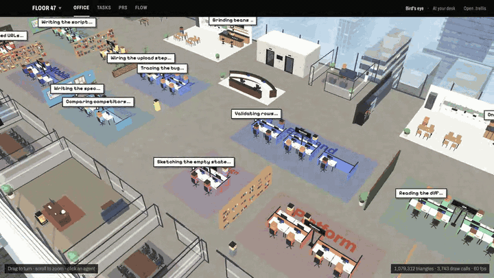
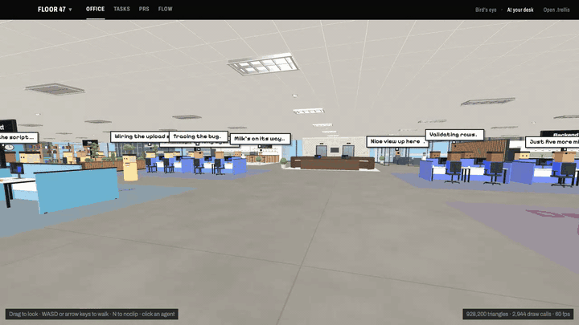

# Trellis

Welcome to the 47th floor.

Congratulations on your promotion. You are now the manager to a team of agents who are thrilled to be here. Your job is now to micromanage, hold standups, and make sure that your team is working hard.

Make no mistakes.

  
  

## What is Trellis

Trellis is an application that runs a team of Claude Code agents as an office you can walk around.

You set the team up once, then hand it work. Trellis runs each agent's jobs on your codebase, passes results from one agent to the next, and stops to ask you whenever a decision or a risky action needs a human.

With it you can:

- **Build a team.** An agent for each part of your process (research, specs, design, building, review, release), each with its own instructions, tools and limits.
- **Run a pipeline.** Chain agents so one finishing starts the next, from an idea to a reviewed PR.
- **Work in parallel.** Many jobs at once, each in its own git worktree with its own branch and PR.
- **Stay in charge.** Allow tools, answer check-ins, sign off results and send PR review comments back, all in one place.
- **See everything.** Follow any job live, see the whole pipeline in the Flow tab, or walk the floor.
